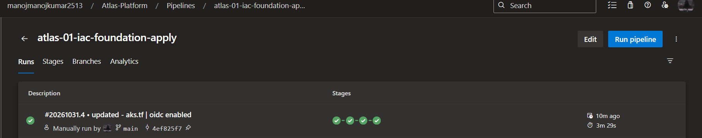
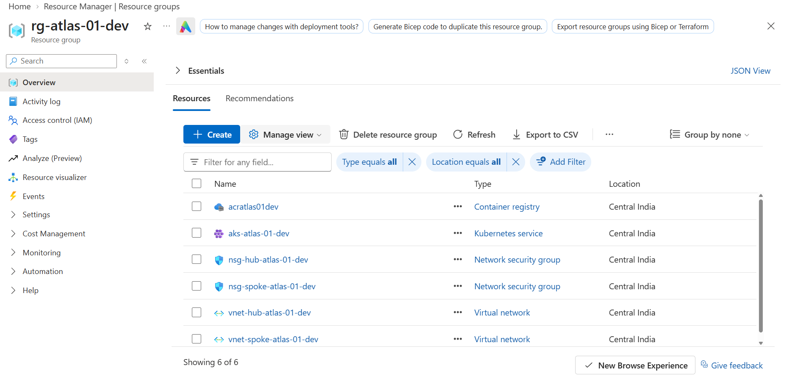
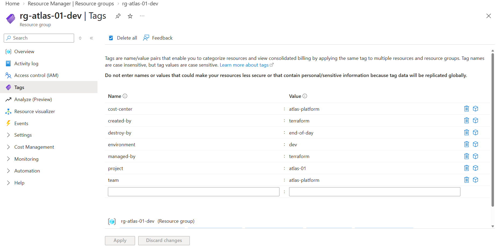

# atlas-01-iac-foundation

**Infrastructure as Code Foundation** — Production-grade AKS cluster with hub-spoke networking, Terraform remote state, feature flags, and FinOps tagging. Deployed and validated entirely via Azure DevOps pipelines.

Part of the [Atlas Platform](https://github.com/manoj-2606) portfolio — 11 production-grade Azure cloud projects.

---

## Problem

Provisioning Kubernetes infrastructure manually leads to configuration drift, undocumented dependencies, and untagged resources that can't be attributed for cost. Teams need a repeatable, auditable, pipeline-driven approach with cost visibility from Day 1.

## Solution

A Terraform-based IaC foundation that provisions a complete AKS environment using hub-spoke network topology. Every resource is tagged for cost attribution. Feature flags toggle components without code changes. Post-deploy validation scripts verify infrastructure health independently of Terraform.

---

## Architecture

```
┌─────────────────────────────────────────────────────────┐
│  Resource Group: rg-atlas-01-dev                         │
│                                                           │
│  ┌──────────────────┐       ┌──────────────────────────┐ │
│  │  Hub VNet         │       │  Spoke VNet               │ │
│  │  10.0.0.0/16      │◄─────►│  10.1.0.0/16              │ │
│  │  snet-hub-shared  │       │  snet-aks-atlas-01-dev    │ │
│  │  + NSG            │       │  + NSG (deny SSH, allow   │ │
│  │                   │       │    hub traffic)            │ │
│  │  (future: FW,     │       │                           │ │
│  │   Bastion, VPN)   │       │  AKS nodes live here      │ │
│  └──────────────────┘       └──────────────────────────┘ │
│        Bidirectional VNet Peering (feature-flagged)        │
│                                                           │
│  ┌──────────────────┐       ┌──────────────────────────┐ │
│  │  AKS Cluster      │       │  ACR (Basic SKU)          │ │
│  │  1x Standard_B2s  │──────►│  (feature-flagged)         │ │
│  │  Azure CNI        │ Pull  │  Admin disabled            │ │
│  │  Calico policy    │       │  AcrPull via managed ID    │ │
│  │  SystemAssigned MI │       └──────────────────────────┘ │
│  └──────────────────┘                                     │
│                                                           │
│  Tags: project | environment | team | cost-center |       │
│        created-by | managed-by | destroy-by                │
└─────────────────────────────────────────────────────────┘
```

## Proof of Execution

### Pipeline — All 4 Stages Passed


### Resource Group — All Resources Deployed


### FinOps Tags — Applied to Every Resource


---

## Tech Stack

| Technology | Purpose |
|-----------|---------|
| **Terraform** (~> 3.100 azurerm) | Infrastructure provisioning |
| **Azure DevOps Pipelines** | CI/CD — bootstrap, plan, apply, validate, destroy |
| **PowerShell** (Az module) | Post-deploy and post-destroy validation |
| **Bash** | Terraform CLI operations, backend bootstrap |
| **Azure CNI** | Pod networking — real VNet IPs per pod |
| **Calico** | Network policy enforcement |
| **gitleaks** | Pre-commit secret detection |

## Key Design Decisions

### Hub-Spoke Over Single VNet
Hub-spoke provides network isolation between workloads. Hub hosts shared services (firewall, bastion, VPN). Spokes host workloads. Each spoke is isolated — blast radius contained. Peering is not transitive: Spoke-A cannot reach Spoke-B through hub without an NVA.

Full explanation: [docs/hub-spoke-explained.md](docs/hub-spoke-explained.md)

### SystemAssigned Identity Over Service Principal
AKS uses a managed identity instead of a service principal. No credential rotation needed. Azure manages the lifecycle. The kubelet identity gets `AcrPull` role on ACR — nodes pull images via RBAC, not shared passwords.

### Azure CNI Over Kubenet
Every pod gets a real VNet IP. Required for VNet peering, NetworkPolicy enforcement, and production workloads. Trade-off: consumes more subnet IPs — subnet must be sized accordingly (/24 minimum for AKS).

### B2s Over D2s (FinOps)
B2s: 2 vCPU, 4GB RAM — $0.042/hr. D2s: 2 vCPU, 8GB RAM — $0.096/hr. D2s is 2.3x the cost for RAM we don't need in non-prod. OS disk reduced from default 128GB to 30GB.

Full cost analysis: [COST.md](COST.md)

## Features

- **Hub-spoke topology** — Network isolation with bidirectional VNet peering
- **Feature flags** — `enable_acr` and `enable_peering` toggle components via variables
- **Remote state** — Azure Blob backend with lease locking, bootstrapped by pipeline
- **OIDC authentication** — Pipeline authenticates via federated credential, zero stored secrets
- **FinOps tagging** — 7 tags on every resource for cost attribution
- **Post-deploy validation** — PowerShell script verifies AKS health, tags, ACR, peering
- **Post-destroy validation** — Confirms RG deleted, checks for orphaned resources
- **Right-sized SKUs** — B2s nodes, 30GB OS disk, Basic ACR — documented cost justification

## Pipeline Flow

### Deploy Pipeline (`azure-pipelines.yml`)
```
Bootstrap ──► Plan ──► Apply (approval gate) ──► Validate (PowerShell)
   │             │          │                          │
   │             │          │                          ├─ AKS health check
   │             │          │                          ├─ Tag compliance (7 tags)
   │             │          │                          ├─ ACR verification
   │             │          │                          └─ Peering status
   │             │          │
   │             │          └─ Applies exact plan artifact
   │             └─ Publishes plan as pipeline artifact
   └─ Creates backend storage (idempotent)
```

### Destroy Pipeline (`azure-pipelines-destroy.yml`)
```
Destroy (approval gate) ──► Validate Cleanup (PowerShell)
   │                               │
   │                               ├─ RG deletion confirmed (polling)
   │                               ├─ MC_* node RG gone
   │                               └─ Orphaned disk check
   │
   └─ terraform destroy -auto-approve
```

## Feature Flags

| Flag | Default | Effect |
|------|---------|--------|
| `enable_acr` | `true` | Provisions/skips Azure Container Registry |
| `enable_peering` | `true` | Creates/skips hub-spoke VNet peering |
| `aks_node_count` | `1` | Scales AKS default node pool (1-5) |

```hcl
# Disable ACR to save ~₹15/day
enable_acr = false

# Test isolated spoke (no hub connectivity)
enable_peering = false
```

## File Structure

```
atlas-01-iac-foundation/
├── terraform/
│   ├── main.tf                    # Provider + required_providers
│   ├── backend.tf                 # Remote state (azurerm backend, values injected by pipeline)
│   ├── variables.tf               # All inputs + feature flags + validation blocks
│   ├── locals.tf                  # Naming conventions + 7 FinOps tags
│   ├── hub-network.tf             # Hub VNet + subnet + NSG
│   ├── spoke-network.tf           # Spoke VNet + AKS subnet + NSG
│   ├── peering.tf                 # Bidirectional peering (feature-flagged)
│   ├── aks.tf                     # AKS cluster + AcrPull role assignment
│   ├── acr.tf                     # ACR Basic (feature-flagged)
│   ├── outputs.tf                 # All outputs for validation scripts
│   └── terraform.tfvars           # Dev defaults (auto-loaded)
├── scripts/
│   ├── Validate-Deployment.ps1    # 7-check post-deploy verification
│   └── Validate-Cleanup.ps1       # Post-destroy RG + orphan check
├── azure-pipelines.yml            # Deploy: bootstrap → plan → apply → validate
├── azure-pipelines-destroy.yml    # Destroy: teardown → validate cleanup
├── docs/
│   ├── hub-spoke-explained.md     # Hub-spoke topology deep dive
│   ├── pipeline-success.png       # Proof: all 4 stages green
│   ├── resource-group.png         # Proof: all resources deployed
│   └── tags-proof.png             # Proof: FinOps tags on resources
├── TROUBLESHOOTING.md             # State lock recovery, subnet conflicts, peering fixes
├── COST.md                        # SKU justification + cost breakdown
├── .pre-commit-config.yaml        # gitleaks + terraform_fmt + terraform_validate
├── .gitignore
└── README.md
```

## Cost

| Resource | Hourly (INR) |
|----------|-------------|
| AKS Control Plane | ₹0 (free) |
| 1x B2s Node | ~₹3.50 |
| ACR Basic | ~₹0.58 |
| VNet / NSG / Peering | ₹0 |
| **Total** | **~₹4.25/hr** |

Actual spend for this execution: **under ₹50** (deploy → verify → destroy in ~2 hours)

Full cost analysis with SKU justification: [COST.md](COST.md)

## Prerequisites

1. Azure Pay-As-You-Go subscription
2. ADO project `Atlas-Platform` with service connection `MI-ADO-API` (OIDC)
3. Variable group `atlas-01-vars`:
   - `serviceConnection` = `MI-ADO-API`
   - `backendResourceGroup` = `rg-atlas-tfstate`
   - `backendStorageAccount` = `atlastfstate2606`
   - `backendContainer` = `tfstate`
   - `backendKey` = `atlas-01.tfstate`
   - `location` = `centralindia`
4. ADO environments: `atlas-01-deploy`, `atlas-01-destroy`

## Deploy

1. Push code to ADO repo (`atlas-01-iac-foundation`)
2. Create pipeline from `azure-pipelines.yml`
3. Run pipeline → approve at Apply stage
4. Validate stage confirms deployment health automatically

## Cleanup

Run the destroy pipeline (`azure-pipelines-destroy.yml`), or manual fallback:

```bash
az group delete --name rg-atlas-01-dev --yes --no-wait
```

Verify: Azure Portal → Resource Groups → search "atlas-01" → should return empty.

## Troubleshooting

Common issues and recovery steps: [TROUBLESHOOTING.md](TROUBLESHOOTING.md)

Covers: state lock recovery, subnet conflicts, peering disconnects, pipeline auth failures, orphaned resources.

## Skills Demonstrated

- **Terraform** — remote state, feature flags (`count`), validation blocks, conditional resources, locals, outputs
- **Azure Networking** — hub-spoke topology, bidirectional VNet peering, NSGs, subnet sizing for Azure CNI
- **AKS** — SystemAssigned managed identity, Azure CNI, Calico network policy, AcrPull role assignment
- **Azure DevOps** — 4-stage pipeline, plan artifacts, approval gates, `AzureCLI@2` + `AzurePowerShell@5` mix
- **FinOps** — 7 cost tags on every resource, right-sized SKUs with documented justification, ephemeral infra
- **DevSecOps** — gitleaks pre-commit, OIDC authentication (zero stored credentials), ACR admin disabled
- **PowerShell** — post-deploy validation (AKS health, tag compliance, ACR, peering), post-destroy orphan check
- **Bash** — Terraform CLI operations, backend storage bootstrap

## What I Learned

- Hub-spoke is overkill for a single workload but demonstrates enterprise architecture thinking — the topology is what gets discussed in interviews, not the workload count
- Azure CNI consumes more IPs than expected — subnet sizing must account for max_pods × node_count from Day 1
- Terraform plan artifacts ensure what you review is exactly what gets applied — no drift between plan and apply stages
- PowerShell validation catches issues Terraform can't report — like peering state being "Connected" vs "Initiated" or tag compliance across resources
- Feature flags in Terraform (`count` with bool variables) reduce the need for separate environment directories — same code, different toggles
- The `destroy-by: end-of-day` tag is a FinOps signal that automated cleanup tools can act on — it communicates intent, not just ownership

---

**Author:** Manoj Kumar R (Monarch)
**Part of:** [Atlas Platform](https://github.com/manoj-2606) — 11-project Azure cloud portfolio
**Target Role:** Senior DevOps / Platform Engineer — Netherlands | Finland | Sweden | Ireland